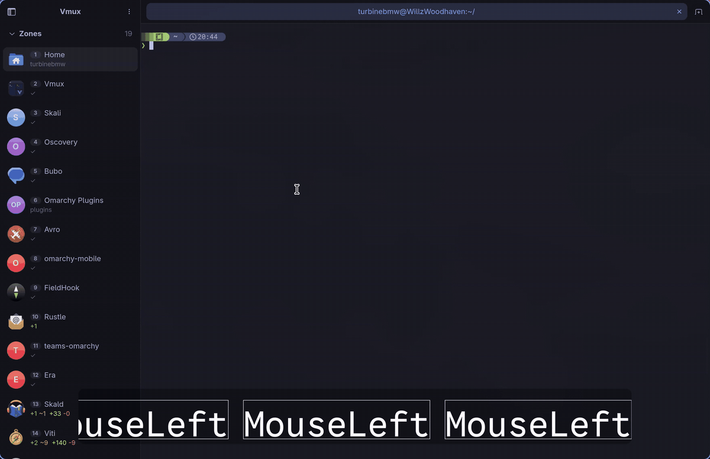
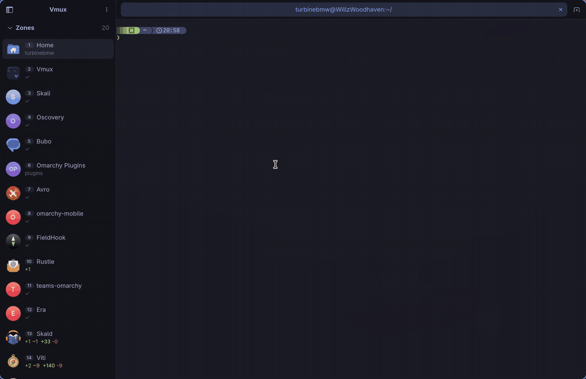
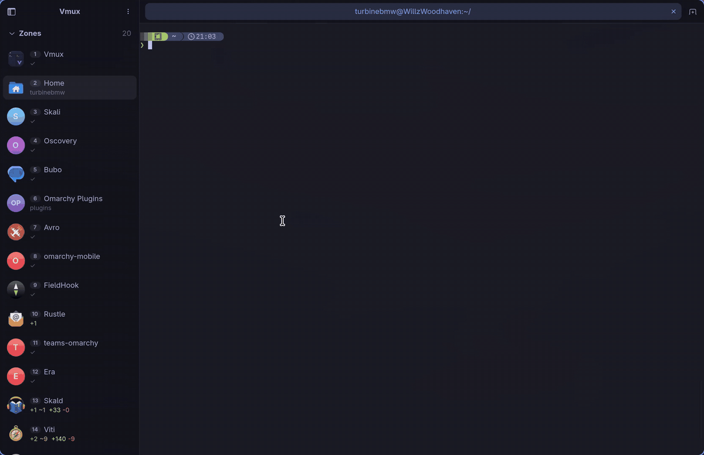
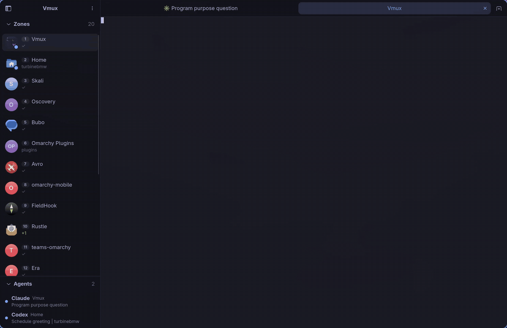
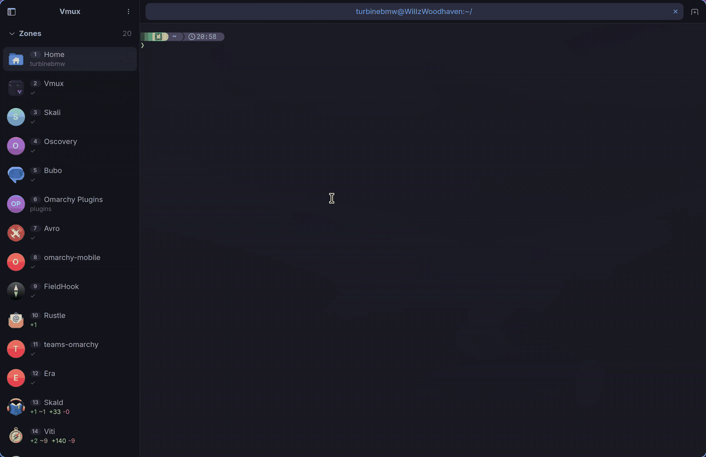

# Vmux

**A terminal workspace for people who run five projects and three coding
agents at once.** A [cmux](https://github.com/manaflow-ai/cmux)-style shell
for Linux, built on **GTK4 + libadwaita + VTE**. It idles at ~0% CPU, so
the only thing eating your battery is the agents.



## The tour

### 🗂️ Zones, splits and tabs

Each **zone** in the sidebar is a project workspace with its own layout, tabs,
directories and focused pane. Split right or down as often as you like. Every
pane gets its own tab strip, and you can drag tabs between panes. Close a
pane's last tab and the split folds back up.

```
┌──────────┬───────────────────────────┬───────────────────┐
│ zones    │ [tab][tab][tab]        +  │ [tab]          +  │
│          ├───────────────────────────┤                   │
│ ~ main   │                           │                   │
│ ● work   │  $ nvim .                 │  $ claude         │
│   blog   │                           │                   │
└──────────┴───────────────────────────┴───────────────────┘
```

- `Alt+1`…`9` jumps straight to a zone, `Ctrl+Alt+L` flips back to the last
  one, and `Ctrl+Alt+/` opens a search-as-you-type switcher that searches zones *and* the
  agents running inside them.
- Every zone shows its **git branch and dirty state** under its name, plus a
  picture chip (initials by default, or right-click it to pick an image).
- The zone list folds away under its header when you'd rather see agents.
- Layout, tabs and directories all survive a restart.

### 📁 New zone, new folder



`Ctrl+Shift+N` opens a path picker that completes as you type. Name a folder
that doesn't exist yet and Vmux creates it and opens the zone there, which is
handy for "I have an idea, start a project *now*".

### 🤖 Coding agents, herded



Vmux recognizes **Claude Code, Codex, Gemini CLI, OpenCode and Copilot CLI** in
any tab.

- Tabs show a spinner while an agent works and a mark when it's waiting on you
  or finished while you were away. The zone's picture rings until you look.
- The **Agents** section lists every agent in every zone, most urgent first.
  Click one, or press `Ctrl+Alt+A`, to jump to whoever needs you.
- Optional desktop notifications for agents that don't send their own.
- **Resume agents after restart** reopens each tab's Claude Code conversation
  where you left it. Vmux adds a session hook to `~/.claude/settings.json`,
  and removes it again when you turn the option off.

### 💬 Ask Agent



Forgot the `find` flags again? Press `Ctrl+Alt+'` and describe what you want.
Your own Claude Code or Codex (the CLI you already pay for, with no extra AI
service) writes the command and **puts it at your prompt without running it**.
You read it and press Enter. Claude answers on Haiku with no tools, so it's
quick.

Switch the popup to **Agent** (or press `Ctrl+Alt+;`) and a full agent opens in
a split next to you to do the work itself. Either way it runs in your
terminal's directory, and can see the recent output when you tick *Include
what's on screen*, so "why did that fail?" just works.

### 🎨 Themes that follow your desktop



On [Omarchy](https://omarchy.org/), *Appearance → Follow Omarchy theme*
recolours Vmux live on every `omarchy theme set`: terminal palette, chrome,
tabs and git colours. A theme can also ship its own `vmux.css`.

Not on Omarchy? Every colour, font and chrome setting is a CSS token in
`~/.config/vmux/style.css`. Edit it from Preferences or by hand, watch it
apply instantly, and save the result as a named theme.

### ✨ And also

- **🔔 Real notifications.** OSC 9 / 777 / kitty OSC 99 (from Claude Code,
  ninja, `notify-send`-style helpers and so on) raise a desktop notification
  naming the zone. Click it to go there. A bell in a hidden zone puts a dot
  on its sidebar entry.
- **🖼️ Inline images.** SIXEL, kitty graphics and iTerm2 images all render
  (`icat`, `chafa`, `timg`, `yazi`, `ranger`/`lf` previews, matplotlib…), using
  Vmux's own [libvte fork](https://github.com/turbineBMW/vte).
- **🌐 Remote host tabs.** A tab running `ssh`, `mosh`, `et` or `telnet` is
  titled with the host. Hover it to see what `ssh -G` resolves. With OSC 7 on
  the remote side, `ssh bastion` → `ssh db` relabels the tab with the innermost
  hop.
- **⌨️ Every key is rebindable** in Preferences.

## Install

Arch: `pacman -S --needed base-devel gtk4 libadwaita meson ninja glib2-devel
pkgconf`, plus a Rust toolchain. Other distros need the equivalent dev
packages, and libadwaita ≥ 1.6.

```sh
./install.sh          # builds everything into ~/.local/bin, plus .desktop + icons
```

Or run it from the tree:

```sh
cargo build --release && ./target/release/vmux
```

<details>
<summary>What's actually being built</summary>

- **The vendored libvte.** `scripts/build-vte.sh` (run by `install.sh`) builds
  the [libvte fork](https://github.com/turbineBMW/vte) (branch
  `image-support`, tracking libvte 0.84) into `vendor/vte`, and
  `.cargo/config.toml` points the build and rpath at it. The system `vte4`
  package can stay installed. To use a local checkout, set
  `VTE_SRC=/path/to/vte`.
- **Two binaries.** `vmux` is the app. `vmux-relay` is a small
  `script(1)`-style PTY shim in front of your shell: libvte has no hook for
  unknown OSC sequences, so the relay picks out notification OSCs and passes
  them to Vmux as termprops, leaving everything else untouched. Keep both on
  `PATH`.

</details>

## Keybindings

All of these can be rebound under Preferences → Keybindings (`Ctrl+,`). Click
a row and press the new keys. Backspace unbinds and Esc cancels.

| Key | Action |
|---|---|
| `Ctrl+Shift+T` / `Ctrl+Shift+W` | New tab (same directory) / close tab |
| `Ctrl+PageUp` / `Ctrl+PageDown` | Previous / next tab |
| `Ctrl+Shift+E` / `Ctrl+Shift+O` | Split right / down |
| `Ctrl+Shift+A` | Focus next pane |
| `Ctrl+Alt+←/→/↑/↓` | Focus pane in that direction |
| `Ctrl+Shift+=` / `Ctrl+Shift+-` | Grow / shrink pane |
| `Ctrl+Shift+N` | New zone |
| `Ctrl+Alt+W` / `Ctrl+Alt+R` | Close / rename zone |
| `Ctrl+Alt+PageUp` / `Ctrl+Alt+PageDown` | Previous / next zone |
| `Ctrl+Shift+PageUp` / `Ctrl+Shift+PageDown` | Move zone up / down |
| `Alt+1`…`Alt+9`, `Ctrl+Alt+1`…`Ctrl+Alt+0` | Switch to zone N |
| `Ctrl+Alt+L` | Last focused zone |
| `Ctrl+Alt+/` | Zone & agent switcher |
| `Ctrl+Alt+A` | Go to agent needing attention |
| `Ctrl+Alt+'` | Ask for a command |
| `Ctrl+Alt+;` | Ask an agent in a new split |
| `Ctrl+Shift+C` / `Ctrl+Shift+V` | Copy / paste |
| `Ctrl+=` / `Ctrl+-` / `Ctrl+0` | Font size |
| `F9` | Toggle sidebar |
| `Ctrl+,` | Preferences |

## Configuration

Preferences (gear icon or `Ctrl+,`) has three pages:

- **General** covers scrollback, shell override, window behaviour, and
  notifications (on/off, notify on bell, sound). Vmux plays the sound itself
  after sending the desktop notification, including on desktops whose
  notification service ignores sound hints. Omarchy and GNOME do-not-disturb
  settings are respected.
- **Appearance** covers Omarchy theme following, saved themes, and labelled
  controls for font, terminal/ANSI colours, chrome, indicators and git colours.
- **Keybindings** lets you rebind every action.

| Path | Contents |
|---|---|
| `~/.config/vmux/state.json` | Zones, layout, tabs, settings and keybinding overrides |
| `~/.config/vmux/style.css` | Live stylesheet, with every token documented inline |
| `~/.config/vmux/themes/*.css` | Named theme snapshots |

For a see-through terminal, give `vmux_terminal_background` an `rgba()` with
alpha < 1.

<details>
<summary>Omarchy theme details</summary>

The palette is read from `~/.local/state/omarchy/current/theme/colors.toml`
with the same fallbacks as `omarchy-theme-color`, so themes match Alacritty
and Ghostty exactly. Legacy `color0`..`color15` themes work too. It's layered
*over* `style.css`, so turning it off restores your own colours. While it's
on, font, opacity and the alpha of `vmux_terminal_background` still apply.
A theme can take full control with a `vmux.css` (same tokens as `style.css`)
in its directory, or generated from `~/.config/omarchy/themed/vmux.css.tpl`.

</details>

<details>
<summary>Directory tracking (OSC 7)</summary>

New tabs open in the current directory, and directories persist across
restarts, when your shell emits OSC 7. foot users usually have this already.
For zsh:

```zsh
function _vmux_osc7() { printf '\e]7;file://%s%s\e\\' "$HOST" "$PWD" }
add-zsh-hook -Uz chpwd _vmux_osc7 && _vmux_osc7
```

Without it, new tabs fall back to the zone's directory.

</details>

## Development

```sh
cargo test                 # unit tests (state, OSC scanner, splits, …)
cargo clippy --all-targets
cargo run                  # debug build
```

`src/lib.rs` is the core, shared by the desktop app, the PTY shim and other
front-ends such as a phone app. It holds zone/tab state (`state`), terminals
(`term`, whose `TerminalHost` trait is how a front-end hears about focus,
bells, notifications and exit), the relay (`relay`, `osc_scan`), remote-host
labels (`remote`, `remote_tab`), agent detection (`agents`), notifications
(`notify`), git status (`git`) and theming (`omarchy`, `style`,
`text_bindings`). `src/main.rs` is the desktop app, with one module per UI
concern (`zone`, `pane`, `splits`, `leaf`, `appearance`, `keybinds`, …).
`src/bin/vmux-relay.rs` is the PTY shim.

## Known limitations

- A tab's title/cwd tracking follows its first terminal.
- State saves on change (debounced) and on close, but not on SIGKILL or a crash.
- Apart from Claude Code with *Resume agents* on, running programs aren't
  restored. Tabs reopen as shells in their saved directories.
- The UI is always dark.
- Linux only (Linux PTYs and the freedesktop notification bus).

## License

[MIT](LICENSE)
